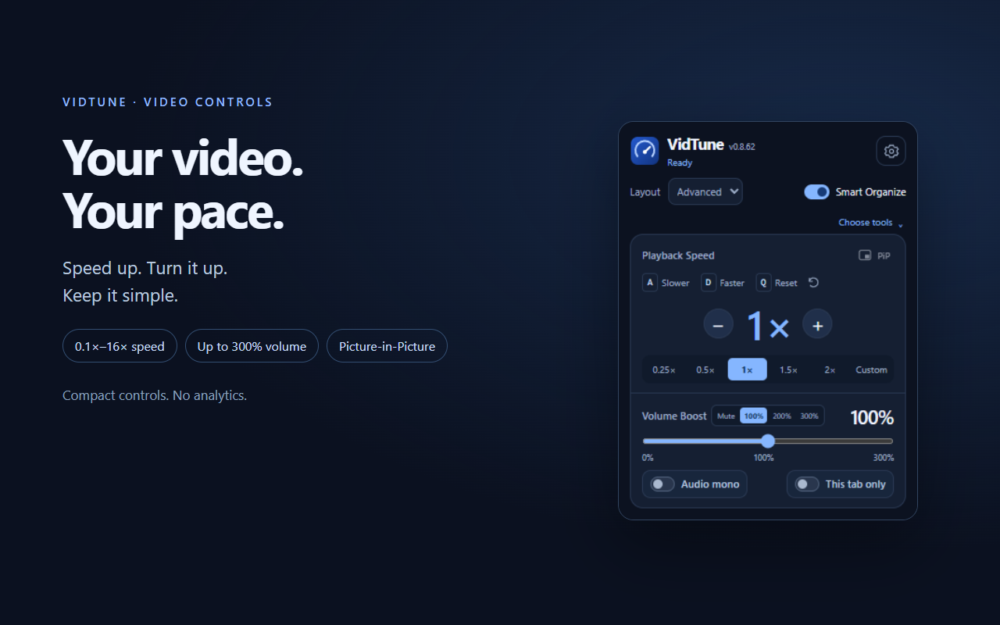
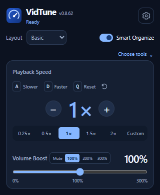
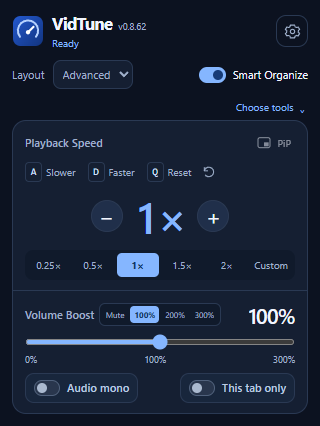
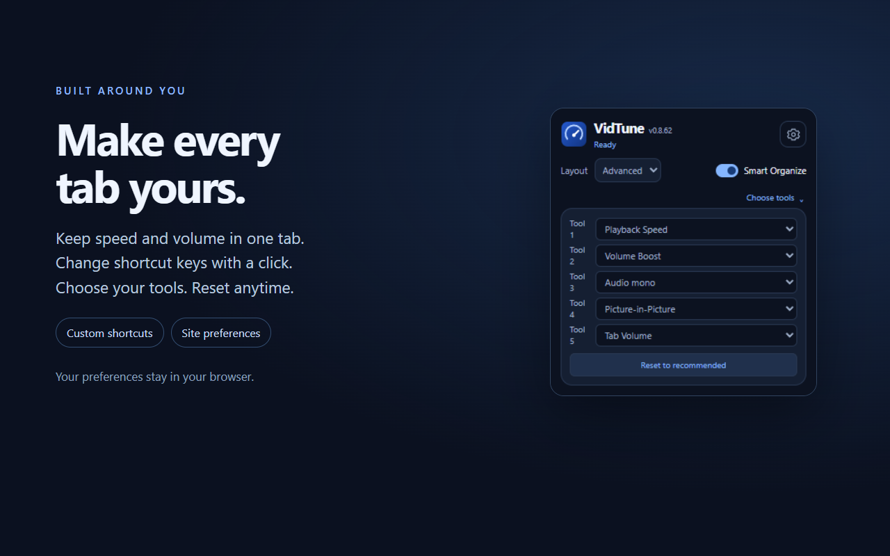

# VidTune — Video Speed & Volume

**Your video. Your pace.** Adjust speed from **0.1× to 16×**, boost quiet audio up to **300%**, and pop videos out with Picture-in-Picture — from one compact panel.

[Get it for Firefox](https://addons.mozilla.org/firefox/addon/vidtune/) · [Microsoft Edge](https://microsoftedge.microsoft.com/addons/detail/iocecgnikgeoainkjndpejfgblgnkpmo) · [Download 0.8.62](https://github.com/lucaseddd/VidTune-Speed-Volume-PiP/releases/tag/v0.8.62)

- **Simple or powerful:** Basic keeps speed and volume close. Advanced adds Audio mono, PiP and independent tab settings. Choose your tools and reset anytime.
- **Your keys, everywhere:** Click a shortcut to change it. The popup and Settings stay in sync.
- **One tab, your settings:** Keep speed and volume in that tab, even when the next video starts. Save site preferences when you want them.
- **Quiet by design:** Basic skips the video overlay and its extra event handlers. No analytics; preferences stay in your browser.

## Preview

| Basic | Advanced |
| :---: | :---: |
|  |  |

## Install

Use the browser store for signed installation and automatic updates. The [release](https://github.com/lucaseddd/VidTune-Speed-Volume-PiP/releases/tag/v0.8.62) also includes the source archive, a Chromium build ZIP and a Firefox build. The release notes identify the Firefox signing status.

Some protected videos and restricted pages limit playback controls. Audio boost depends on the player allowing audio processing.

## Changelog

### 0.8.62

- New Basic and Advanced layouts, adaptive height and a refreshed compact interface.
- Editable shortcuts synchronized with Settings, plus a one-click A/D/Q reset.
- New speed presets and an inline Custom value from 0.1× to 16×.
- Tab-only speed and volume survive video navigation without changing global preferences.
- Player volume and mute continue working with amplified audio.
- Refreshed audio switches, centered volume presets and recommended-tool reset.
- Firefox-specific packaging omits the unsupported service worker property.
- Updated screenshots and shorter product descriptions.

### 0.81

- Introduced the adaptive popup and fixes for player volume and tab settings.

## Build

Requires Node.js 20 or later.

~~~sh
npm ci
npm run build
npm run package
~~~

Firefox, Chromium and source archives are written to `release/`.

[Privacy](PRIVACY.md) · [Support / issues](https://github.com/lucaseddd/VidTune-Speed-Volume-PiP/issues)
